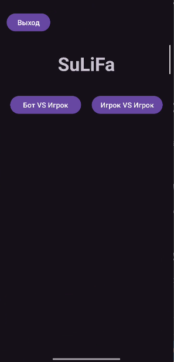
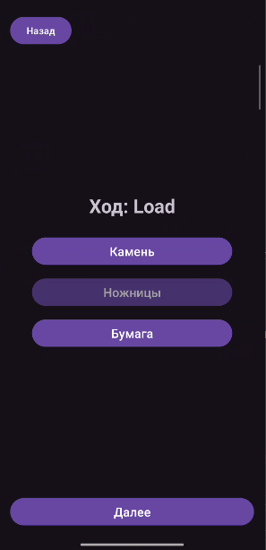
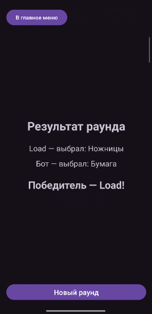

# SuLiFa

Учебное Android-приложение «Камень, ножницы, бумага».

## Возможности

- Игра против бота.
- Игра двух игроков на одном устройстве.
- Ввод никнеймов.
- Отображение выборов и результата раунда.
- Новый раунд с сохранением имён и режима.

## Технологии

- Kotlin.
- XML-разметка.
- Три Activity: MainActivity, ChoiceActivity, ResultActivity.
- Переходы через явные Intent с передачей данных через putExtra().
- LinearLayout и RelativeLayout.
- Логирование жизненного цикла и действий пользователя.

## Версии

- Минимальная версия: Android 8.0, API 26.
- compileSdk: 37.
- targetSdk: 37.
- Версия приложения: 1.0.

## Скриншоты

## Логи

Журнал работы: [logs.txt](logs/logs.txt).

## APK

[Скачать SuLiFa v1.0 для Android](https://github.com/LoadOnnik/SuLiFa/releases/download/v1.0)
